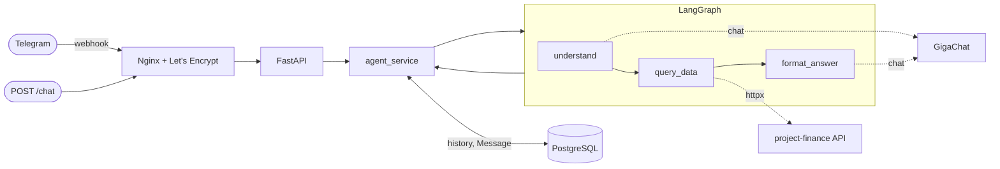

# 🤖 Finance Agent

[](https://github.com/daniil-avdeenko/FastApi-Finance-Agent/actions/workflows/ci.yml)
[](https://github.com/daniil-avdeenko/FastApi-Finance-Agent/releases)
[](https://www.python.org/downloads/)
[](LICENSE)

> **Демо-данные.** Бот работает с публичной демонстрационной базой системы
> [project-finance](https://github.com/daniil-avdeenko/project-finance).
> Все проекты, компании и сотрудники вымышлены, совпадения случайны.

📱 **Telegram-бот:** [@project_finance_agent_bot](https://t.me/project_finance_agent_bot)

Telegram AI-агент для системы [project-finance](https://github.com/daniil-avdeenko/project-finance).
Отвечает на вопросы о проектах и финансах на естественном языке.

Агент не ходит в БД основного проекта напрямую — только через публичный
REST API `/api/v1/*`. Развязка сервисов, отказ от shared-credentials,
независимый деплой.

## Архитектура



**Поток запроса.** `FastAPI` принимает запрос от Telegram (webhook) или
напрямую через `POST /chat`, и передаёт его в `agent_service`. Сервис
читает историю последних 5 сообщений по `chat_id` из PostgreSQL и
запускает LangGraph-граф.

`understand` вызывает LLM (GigaChat) и классифицирует вопрос в
`intent` + `params`. `query_data` по этому intent вызывает нужный tool —
HTTP-запрос к публичному API основного проекта через httpx.
`format_answer` рендерит ответ: для структурированных интентов
(транзакции, прибыль, топ, сравнение) — в Python, для остальных —
вторым вызовом LLM.

Узлы не роняют граф при ошибках: сетевые сбои, 4xx/5xx, падение LLM
пишутся в `state.error` и попадают в ответ пользователю как понятный текст.

**Контекст диалога.** Граф stateless: каждый вопрос независим. Последние
5 сообщений по `chat_id` подкладываются в промпт `understand` — это
позволяет LLM правильно обработать уточняющие сообщения («а за прошлый
месяц?», «а по проекту 3?», «а рентабельность?»).

## Возможности

| Интент | Пример вопроса |
|---|---|
| `summary` | Сводка по финансам за август |
| `projects` | Список проектов |
| `project_detail` | Детали проекта 2 |
| `transactions` | Перечисли транзакции по проекту 1 за август |
| `count` | Сколько транзакций было в августе по проекту 4 |
| `aggregate` | Суммарный доход за июль |
| `profit` | Прибыль по проектам за май |
| `profitability` | Рентабельность за июнь |
| `top_n` | Топ-3 проекта по прибыли за август |
| `compare` | Сравни прибыль май и июнь |
| `currencies` | Курсы валют |

**Форматирование ответов.** Структурированные ответы (транзакции, агрегаты,
профит, топ, сравнение) рендерятся в Python, а не LLM: модель путает
поля соседних записей, теряет метки метрик, дублирует числа. Числа
форматируются единообразно — разделители тысяч пробелами, десятичная
запятая, символ `₽`, проценты с двумя знаками, даты `DD.MM.YYYY`.

## Примеры диалога

<table>
<tr>
<td></td>
<td></td>
<td></td>
</tr>
<tr>
<td align="center"><sub>Стартовый экран с кнопками</sub></td>
<td align="center"><sub>Прибыль по проектам</sub></td>
<td align="center"><sub>Топ проектов</sub></td>
</tr>
</table>

## Стек

| Слой | Технологии |
|---|---|
| HTTP | FastAPI, uvicorn, Pydantic v2 |
| Агент | LangGraph, LangChain |
| LLM | GigaChat (основной), OpenRouter (fallback) |
| Telegram | aiogram 3 (webhook + polling) |
| БД | PostgreSQL 16, SQLAlchemy 2.0 async, asyncpg, Alembic |
| HTTP-клиент | httpx |
| Тесты | pytest, pytest-asyncio, testcontainers, respx |
| Качество | ruff, mypy (strict), pre-commit, gitleaks |
| CI | GitHub Actions: tests + lint |
| Инфраструктура | Docker Compose, Nginx, Let's Encrypt, VPS (Ubuntu 22.04) |

## Что реализовано

**Агент.**
- LangGraph-граф с тремя узлами, `lru_cache` на компиляцию.
- `LLMProvider` (Protocol) с тремя реализациями: `MockLLM` для тестов,
  `GigaChatLLM` (langchain-gigachat), `OpenRouterLLM` (openai SDK) как fallback.
- Обработка ошибок LLM и tools: не роняют граф, пишутся в `state.error`.
- Постобработка чисел, дат и ошибок LLM перед отправкой пользователю.

**Публичный API.**
- `POST /chat` — принимает `{chat_id, question}`, гоняет граф, сохраняет
  `Message`, возвращает `{answer, llm_provider, latency_ms}`.
- `POST /telegram/webhook` — приём апдейтов с проверкой secret token.
- `/health` — healthcheck для Nginx и Docker.

**Telegram-бот.**
- aiogram 3: dispatcher, handlers, FSM storage.
- Inline-кнопки быстрого доступа под `/start`.
- Rate limit middleware: скользящее окно на `user_id` (10 запросов/мин).
- Webhook для прода, polling runner для локальной разработки. Runner
  снимает активный webhook перед polling — иначе `409 Conflict`.

**История диалогов.**
- `Message` (chat_id, question, answer, intent, params, llm_provider,
  latency_ms, created_at) в PostgreSQL.
- `intent` + `params` хранятся для контекста — на их основе строится
  промпт следующего вопроса.

**Безопасность.**
- Проверка `X-Telegram-Bot-Api-Secret-Token` на webhook.
- Валидация конфига на старте: GigaChat без credentials не поднимается.
- Санитизация ошибок LLM и API: без URL и технических деталей в ответе.
- gitleaks в pre-commit, секреты только в env.

## Быстрый старт

```bash
git clone https://github.com/daniil-avdeenko/FastApi-Finance-Agent.git
cd FastApi-Finance-Agent

python -m venv .venv
.venv\Scripts\activate                    # Windows
pip install -r requirements-dev.txt

docker compose up -d                      # Postgres + Adminer
cp .env.example .env                      # заполнить GIGACHAT_CREDENTIALS и TELEGRAM_BOT_TOKEN
alembic upgrade head
uvicorn app.main:app --reload
```

- Healthcheck: http://127.0.0.1:8000/health
- Swagger (dev): http://127.0.0.1:8000/docs

### Telegram-бот

**Webhook (прод).** Необходимо установить:

```dotenv
TELEGRAM_MODE=webhook
TELEGRAM_WEBHOOK_URL=https://agent.projectfin.com.ru/telegram/webhook
```

Бот сам вызывает `set_webhook` при старте сервиса.

**Polling (локально).** Публичного HTTPS нет, поэтому бот сам опрашивает
Telegram:

```dotenv
TELEGRAM_MODE=polling
TELEGRAM_BOT_TOKEN=...
```

```bash
python -m app.telegram.runner
```

## Развёртывание на VPS

Production — один VPS (Ubuntu 22.04), Nginx как
reverse proxy, Let's Encrypt для HTTPS, Docker Compose для сервисов.

### Структура

- **Nginx** — терминирует SSL, проксирует:
  - `projectfin.com.ru` → `127.0.0.1:5000` ([project-finance](https://github.com/daniil-avdeenko/project-finance))
  - `agent.projectfin.com.ru` → `127.0.0.1:8000` (этот проект)
- **FastAPI + Telegram webhook** — один контейнер `web` (uvicorn 1 worker).
- **PostgreSQL 16** — изолированная docker-сеть, порт наружу не открыт,
  лимит 384 MB.

### Запуск

```bash
cd /opt/fastapi-finance-agent
docker compose -f docker-compose.prod.yml build
docker compose -f docker-compose.prod.yml up -d
docker compose -f docker-compose.prod.yml logs -f web
```

Миграции запускаются автоматически в `CMD` Dockerfile:
`alembic upgrade head && exec uvicorn ...`.

### Переменные окружения

Секреты хранятся в `/opt/fastapi-finance-agent/.env.prod` (не в репозитории).
Шаблон — `.env.example`. Обязательные:

```dotenv
APP_ENV=production
SECRET_KEY=<random>
POSTGRES_USER=agent
POSTGRES_PASSWORD=<random>
POSTGRES_DB=finance_agent
DATABASE_URL=postgresql+asyncpg://agent:<pass>@postgres:5432/finance_agent

MAIN_API_URL=https://projectfin.com.ru
MAIN_API_TIMEOUT=10

LLM_PROVIDER=gigachat
GIGACHAT_CREDENTIALS=<base64 client_id:secret>
GIGACHAT_SCOPE=GIGACHAT_API_PERS
GIGACHAT_MODEL=GigaChat-3-Pro
GIGACHAT_VERIFY_SSL=false

TELEGRAM_MODE=webhook
TELEGRAM_BOT_TOKEN=...
TELEGRAM_WEBHOOK_URL=https://agent.projectfin.com.ru/telegram/webhook
TELEGRAM_WEBHOOK_SECRET=<random>
TELEGRAM_RATE_LIMIT=10
TELEGRAM_RATE_WINDOW=60
```

Бот работает в продакшене: [@project_finance_agent_bot](https://t.me/project_finance_agent_bot).
Напишите `/start`, затем — любой вопрос. Например: «Сводка за август»
или «Топ-3 проекта по прибыли за июль».
Проверить работоспособность сервиса: [`/health`](https://agent.projectfin.com.ru/health).

## Тесты

```bash
pytest                                    # coverage ≥ 90%
ruff check app/ tests/
ruff format --check app/ tests/
mypy app/
```

- **Unit** — LLM-провайдеры, tools (respx), узлы графа, сборка графа,
  aiogram-хендлеры, throttling, форматтеры чисел и дат.
- **Integration** — `POST /chat`, `/telegram/webhook`, `agent_service`,
  модель `Message` на реальном Postgres через testcontainers.
- **Failure paths** — LLM недоступен, API недоступен, мусор от LLM
  вместо JSON, rate limit, отсутствующий секрет webhook.

## Структура

```
app/
├── agent/            # LangGraph: state, nodes, tools, graph, LLM-провайдеры
│   ├── llm/          # MockLLM, GigaChatLLM, OpenRouterLLM
│   ├── prompts.py    # system-промпты
│   ├── formatters.py # рендер ответов без LLM
│   ├── nodes.py      # understand, query_data, format_answer
│   ├── tools.py      # httpx-обёртки над /api/v1/*
│   ├── graph.py      # сборка LangGraph
│   └── state.py      # AgentState
├── api/              # FastAPI: /chat, /telegram/webhook
├── telegram/         # aiogram: bot, handlers, middlewares, keyboards, runner
├── models/           # SQLAlchemy: Message
├── services/         # agent_service
├── config.py         # pydantic-settings
├── db.py             # engine, session factory
└── main.py           # FastAPI app + lifespan
migrations/           # Alembic
tests/unit/           # быстрые, без БД
tests/integration/    # с реальным Postgres
scripts/              # pip-compile в Linux-контейнере
Dockerfile, docker-compose.yml, docker-compose.prod.yml
```

## Управление зависимостями

Lock-файлы (`requirements*.txt`) собираются `pip-tools` **внутри
Linux-контейнера**. Версия `pip-tools` и Python зафиксированы в
[`scripts/requirements-compile.Dockerfile`](scripts/requirements-compile.Dockerfile).

```bash
./scripts/compile-requirements.sh      # Linux / macOS / Git Bash
.\scripts\compile-requirements.ps1     # Windows PowerShell
```

## Лицензия

MIT
