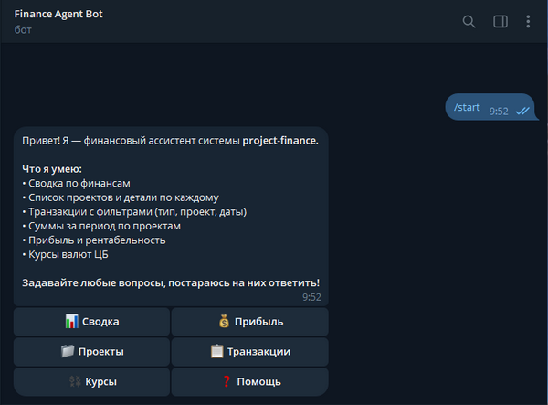
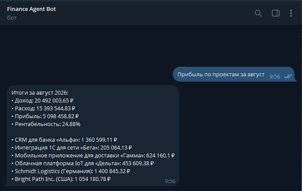
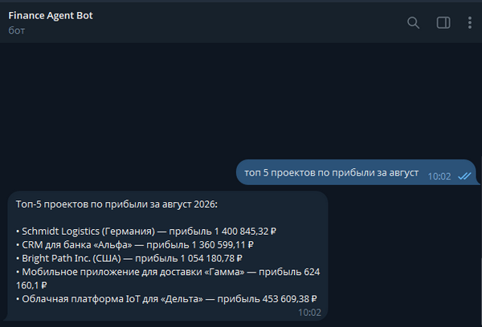
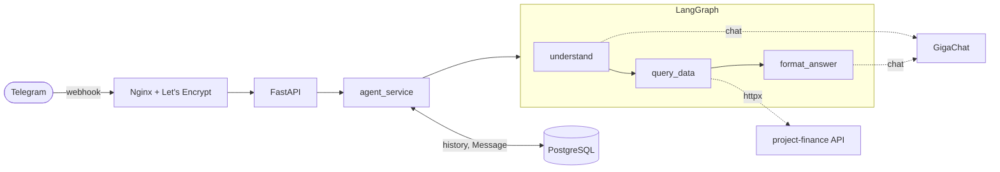

# 🤖 Finance Agent

[](https://github.com/daniil-avdeenko/FastApi-Finance-Agent/actions/workflows/ci.yml)
[](https://github.com/daniil-avdeenko/FastApi-Finance-Agent/releases)
[](https://www.python.org/downloads/)
[](https://github.com/astral-sh/ruff)
[](LICENSE)

Telegram AI-агент на LangGraph + GigaChat для системы учёта финансов
[project-finance](https://github.com/daniil-avdeenko/project-finance). Отвечает
на вопросы о проектах, транзакциях и прибыли на естественном языке. Ходит
в публичный REST API основного проекта — без shared-credentials к его БД.

**Telegram-бот:** [@project_finance_agent_bot](https://t.me/project_finance_agent_bot) —
откройте `/start` и задайте вопрос, например: «Сводка за август», «Топ-3 проекта по прибыли за июль».

**Связанный проект:** [project-finance](https://github.com/daniil-avdeenko/project-finance) —
Flask-приложение с дашбордом, CRUD проектов и транзакций, экспортом в CSV/XLSX,
синхронизацией с Google Sheets.

> Данные в демо — сгенерированные. Все проекты, компании и сотрудники вымышлены.

**Скриншоты:**

| Стартовый экран | Прибыль по проектам | Топ-N проектов |
|---|---|---|
|  |  |  |

## Возможности

- **11 интентов** — сводка, список и детали проектов, транзакции, количество, агрегаты, курсы ЦБ, прибыль, рентабельность, топ-N, сравнение периодов.
- **Контекст диалога** — последние 5 сообщений по `chat_id` подкладываются в промпт, работают уточнения «а за прошлый месяц?», «а по проекту 3?», «а рентабельность?».
- **Структурированные ответы рендерятся в Python** (транзакции, топ-N, прибыль, агрегаты, сравнение) — не зависят от галлюцинаций LLM.
- **Graceful degradation** — падение LLM или основного API не роняет граф, а превращается в человеческий текст. Технические детали в ответ не утекают.
- **Rate limit** на `user_id` в Telegram — sliding window log через Redis, fallback на in-memory при недоступности.
- **GigaChat** как основной провайдер, **OpenRouter** как fallback, **MockLLM** для детерминированных тестов.

## Архитектура



**Ключевые решения:**

- **Развязка сервисов.** Агент общается с `project-finance` только через публичный REST API `/api/v1/*`. Нет shared-credentials к БД — оба проекта можно менять и деплоить независимо.
- **Граф stateless.** Каждый вопрос независим. История последних 5 сообщений читается из PostgreSQL и подкладывается в промпт `understand` — LLM правильно обрабатывает уточняющие вопросы.
- **Рендер в Python.** Для структурированных интентов (транзакции, топ, прибыль, рентабельность, агрегаты, сравнение) ответ собирается кодом, а не LLM: модель путает поля соседних записей, теряет метки метрик и дублирует числа. LLM вызывается только для свободных формулировок.
- **Graceful degradation.** Ошибки LLM и основного API пишутся в `state.error`, а не роняют граф. Пользователь получает понятный текст: 402/403/404/429/timeout маппятся в человеческие сообщения, технические детали (URL, стек) не утекают.
- **Единый формат чисел.** Разделители тысяч — пробелы, десятичная запятая, символ `₽`, проценты с двумя знаками, даты `DD.MM.YYYY`. Одинаково во всех интентах.

## Стек

| Слой | Технологии |
|---|---|
| HTTP | FastAPI, uvicorn, Pydantic v2 |
| Агент | LangGraph, LangChain |
| LLM | GigaChat (основной), OpenRouter (fallback), MockLLM (тесты) |
| Telegram | aiogram 3 (webhook + polling) |
| БД | PostgreSQL 16, SQLAlchemy 2.0 async, asyncpg, Alembic |
| Кэш | Redis 7 (rate limit) |
| HTTP-клиент | httpx |
| Тесты | pytest, pytest-asyncio, pytest-cov, testcontainers, respx, fakeredis |
| Качество | ruff, mypy strict, pre-commit, gitleaks |
| Инфраструктура | Docker Compose, Nginx, Let's Encrypt |

## Быстрый старт

### Локально

```bash
git clone https://github.com/daniil-avdeenko/FastApi-Finance-Agent.git
cd FastApi-Finance-Agent

python -m venv .venv
source .venv/bin/activate              # Windows: .venv\Scripts\activate
pip install -r requirements-dev.txt    # prod + dev-tooling

docker compose up -d                   # Postgres + Adminer + Redis
cp .env.example .env                   # заполнить GIGACHAT_CREDENTIALS и TELEGRAM_BOT_TOKEN
alembic upgrade head
uvicorn app.main:app --reload          # http://127.0.0.1:8000
```

- Healthcheck: `http://127.0.0.1:8000/health`
- Swagger (dev): `http://127.0.0.1:8000/docs`
- Adminer: `http://127.0.0.1:8080`

**Telegram-бот в локальной разработке** — polling-режим, публичный HTTPS не нужен:

```bash
# В .env: TELEGRAM_MODE=polling
python -m app.telegram.runner
```

Runner снимает активный webhook перед стартом — иначе Telegram отдаёт `409 Conflict`.

### Docker (dev)

```bash
docker compose up -d
```

Поднимаются `postgres`, `redis` и `adminer`. Приложение запускается через `uvicorn` локально.

## Интенты

| Intent | Пример вопроса | LLM в `format_answer` |
|---|---|---|
| `summary` | Сводка по финансам за август | да |
| `projects` | Список проектов | да |
| `project_detail` | Детали проекта 2 | да |
| `transactions` | Перечисли транзакции по проекту 1 за август | нет, Python |
| `count` | Сколько транзакций в августе по проекту 4 | нет, Python |
| `aggregate` | Суммарный доход за июль | нет, Python |
| `profit` | Прибыль по проектам за май | нет, Python |
| `profitability` | Рентабельность за июнь | нет, Python |
| `top_n` | Топ-3 проекта по прибыли за август | нет, Python |
| `compare` | Сравни прибыль май и июнь | нет, Python |
| `currencies` | Курсы валют | да |

## Тестирование и CI/CD

- **`pytest`** — 194 теста, покрытие 92%.
  - **Unit** — LLM-провайдеры, tools (respx), узлы графа, сборка графа, aiogram-хендлеры, throttling, cache lifecycle, форматтеры чисел и дат.
  - **Integration** — `POST /chat`, `POST /telegram/webhook`, `agent_service`, модель `Message` на реальном PostgreSQL через testcontainers.
  - **Failure paths** — LLM недоступен, основной API недоступен, мусор от LLM вместо JSON, rate limit, отсутствующий секрет webhook, недоступный Redis (fallback на in-memory).
- **Pre-commit** — ruff (линтер + форматтер), mypy strict, gitleaks, conventional-commit.
- **GitHub Actions** — три параллельных job'а на PR: `Tests`, `Lint & Type Check` (ruff + mypy), `Secrets scan` (gitleaks).
- **Deploy Preview** — на каждый PR собирает изолированный стек, гоняет smoke-тест на `/health`.
- **Deploy** — после merge в `main` через `workflow_run` после зелёного CI. Self-hosted runner на сервере, SSH-порт наружу не открыт.
- **Branch protection** — PR обязателен, зелёные чеки CI, force-push и удаление `main` запрещены.

## Управление зависимостями

Зависимости разделены на prod и dev, lock-файлы генерируются через `pip-tools`.

| Файл | Назначение |
|---|---|
| `requirements.in` | Прямые prod-зависимости без версий |
| `requirements-dev.in` | Prod + dev-tooling (pytest, ruff, mypy, pre-commit) |
| `requirements.txt` | Lock-файл prod (в Docker-образ) |
| `requirements-dev.txt` | Lock-файл dev (локально, в CI) |

**Docker-образ** ставит только `requirements.txt` — без pytest, ruff, mypy и их транзитивных зависимостей.

**Компиляция lock-файлов** — в Linux-контейнере (`scripts/requirements-compile.Dockerfile`), чтобы linux-only пакеты и маркеры платформы резолвились корректно, независимо от ОС разработчика:

```bash
./scripts/compile-requirements.sh      # Linux / macOS / Git Bash
.\scripts\compile-requirements.ps1     # Windows PowerShell
```

## Структура

```
app/
├── agent/                    # LangGraph-агент
│   ├── llm/                  # LLMProvider (Protocol) + реализации
│   │   ├── base.py           #   протокол провайдера
│   │   ├── mock.py           #   MockLLM для тестов
│   │   ├── gigachat.py       #   GigaChat (основной)
│   │   ├── openrouter.py     #   OpenRouter (fallback)
│   │   └── factory.py        #   выбор провайдера по настройкам
│   ├── prompts.py            # system-промпты (understand, format)
│   ├── formatters.py         # рендер ответов в Python без LLM
│   ├── nodes.py              # understand / query_data / format_answer
│   ├── tools.py              # httpx-обёртки над /api/v1/*
│   ├── graph.py              # сборка LangGraph (lru_cache)
│   └── state.py              # AgentState (TypedDict)
├── api/
│   ├── chat.py               # POST /chat
│   └── telegram.py           # POST /telegram/webhook
├── telegram/
│   ├── bot.py                # Bot + Dispatcher
│   ├── handlers.py           # /start, /help, callback, текстовый хендлер
│   ├── keyboards.py          # inline-кнопки быстрых действий
│   ├── runner.py             # polling для локальной разработки
│   └── middlewares/
│       └── throttling.py     # Redis sliding window log + fallback
├── models/
│   └── message.py            # Message (chat_id, question, answer, intent, ...)
├── services/
│   └── agent_service.py      # process_question, история, запись в БД
├── cache.py                  # async-клиент Redis (singleton, graceful degradation)
├── config.py                 # pydantic-settings + валидация на старте
├── db.py                     # engine, session factory
└── main.py                   # FastAPI app + lifespan

migrations/                   # Alembic
tests/
├── unit/                     # быстрые, без БД
└── integration/              # с реальным PostgreSQL (testcontainers)
scripts/                      # pip-compile в Linux-контейнере
Dockerfile, docker-compose.yml, docker-compose.prod.yml
```

## Документация

- [CHANGELOG.md](CHANGELOG.md) — история версий.
- [SECURITY.md](SECURITY.md) — политика безопасности, известные ограничения, канал для ответственного раскрытия уязвимостей.

## Что планируется улучшить

- **Rate limit на HTTP-эндпоинте `/chat`.** Сейчас rate limit работает только на `user_id` в Telegram-боте. Для `/chat` нужен отдельный лимитер на IP или API-ключ.
- **Стриминг ответов.** Для `summary`, `projects` и `currencies` LLM вызывается в `format_answer` — стриминг сократит время до первого байта.
- **HSTS в production.** Заголовок `Strict-Transport-Security` — стандартное усиление HTTPS, отсутствует в текущей конфигурации.
- **Сертификаты Минцифры для GigaChat.** Позволят включить полноценную проверку TLS.
- **Uptime-мониторинг.** Uptime Kuma с пингом `/health` и алертами в Telegram.

## Лицензия

MIT
